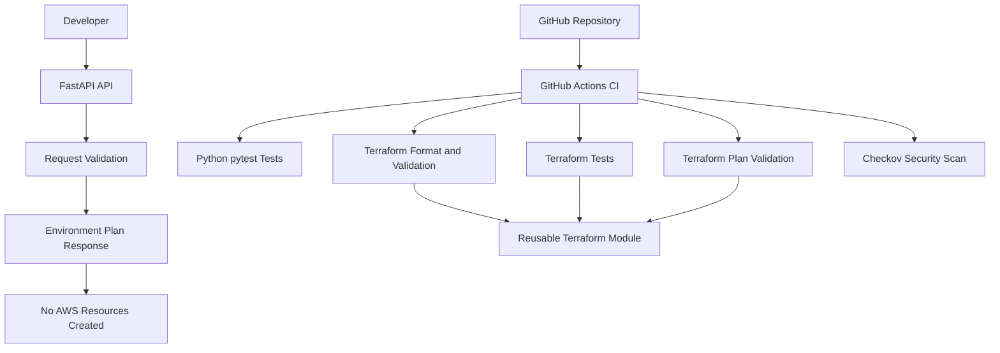

# CloudForge Architecture

## Overview

CloudForge is a self-service developer platform prototype. Developers submit environment requests through a FastAPI endpoint. The API validates the request and returns a plan without provisioning AWS resources.

Terraform provides validated configuration, reusable module outputs, and infrastructure-as-code foundations. GitHub Actions automates testing, validation, planning, and security scanning.

## Architecture Diagram

## Components

| Component | Responsibility |
|---|---|
| FastAPI | Exposes environment planning, health, and platform information endpoints |
| Pydantic | Validates environment request fields and constraints |
| pytest | Tests API behavior and input validation |
| Terraform | Defines validated configuration, module outputs, and resource naming conventions |
| Terraform module | Provides reusable application environment configuration |
| GitHub Actions | Runs automated checks on repository changes |
| Checkov | Scans Terraform configuration for supported security issues |

## Current Limitations

- The API creates plans only; it does not provision AWS infrastructure.
- Terraform currently defines configuration and outputs rather than deployable AWS resources.
- The requested monthly budget is an input-validation limit, not an actual billing control.
- Cost estimation, AWS budget alerts, and automated deployments are planned enhancements.
